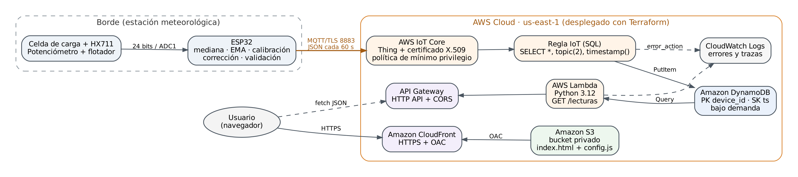

# Pluviómetro gravimétrico IoT con validación cruzada

Proyecto integrador · Ingeniería de Datos e IA · Universidad Santo Tomás, Tunja
Autor: Juan Sebastian Cruz Gallo
Asignaturas: **Cloud Computing** · **Sistemas de Adquisición y Procesamiento de Datos**
ODS: **13 – Acción por el clima** (metas 13.1 y 13.3)

Pluviómetro que mide la lluvia **pesando el agua** con una celda de carga (HX711) y la valida con un
segundo principio físico (flotador + potenciómetro). Un ESP32 filtra, calibra, corrige y valida la señal,
y la publica por MQTT/TLS en AWS IoT Core. La infraestructura en la nube se despliega con **Terraform**.

> **Prototipo simulado.** No se construyó el montaje físico. La adquisición se validó con un
> **gemelo digital** de la señal (`simulacion/gemelo_digital.py`), que ejecuta el mismo algoritmo
> que el firmware; la equivalencia se comprueba con `simulacion/prueba_firmware/verificar_firmware.py`.
> La nube sí está desplegada y probada en una cuenta real de AWS.



## Estructura del repositorio

| Carpeta | Contenido |
|---|---|
| `informe/` | Reporte del avance en formato IEEE (`informe.pdf` y fuente LaTeX) |
| `infra/terraform/` | Infraestructura como código: IoT Core, regla, DynamoDB, Lambda, API Gateway, S3, CloudFront |
| `lambda/` | API de consulta `GET /lecturas` (Python 3.12) |
| `dashboard/` | Tablero web (HTML + Chart.js) |
| `firmware/calibracion_pluviometro/` | Sketch para tomar los puntos de calibración |
| `firmware/pluviometro_mqtt/` | Firmware de operación: 5 etapas de tratamiento + envío MQTT (borrador v0.1) |
| `calibracion/` | Cálculo de factor, offset, bias, regresión y RMSE (`calibracion.py`) |
| `simulacion/gemelo_digital.py` | Gemelo digital: señal cruda con ruido, gotas, viento, deriva y falla de ganancia; mismo tratamiento del firmware, métricas y figuras |
| `simulacion/resultados/` | Métricas (`metricas.json`), lecturas (`publicaciones.jsonl`) y figuras del gemelo |
| `simulacion/prueba_firmware/` | Compila el firmware en el PC con stubs y lo compara con el gemelo |
| `simulacion/wokwi/` | Proyecto de simulación del circuito en Wokwi |
| `costos/` | Estimación reproducible de costos mensuales (`estimacion_costos.py`) |
| `docs/` | Diagrama de arquitectura (fuente Graphviz, PNG y PDF) |

## Despliegue en AWS

Requisitos: Terraform ≥ 1.5 y credenciales de AWS configuradas
(en AWS Academy: *AWS Details → AWS CLI* y copiar en `~/.aws/credentials`).

```bash
cd infra/terraform
cp terraform.tfvars.example terraform.tfvars   # use_lab_role = true en AWS Academy
terraform init
terraform plan
terraform apply
terraform output
```

`terraform apply` también genera:
- `firmware/pluviometro_mqtt/aws_secrets.h`: endpoint, certificado y llave del ESP32 (no se sube a Git).
- `config.js` del tablero, con la URL real de la API.

Al terminar la sesión del laboratorio: `terraform destroy`.

## Firmware

Arduino IDE 2 con el soporte de ESP32 (Espressif) y las librerías **HX711** (Bogdan Necula),
**PubSubClient** y **ArduinoJson 7**. Ajustar `config.h` con el WiFi y las constantes de calibración.

## Calibración

1. Cargar `firmware/calibracion_pluviometro` y, en el monitor serie, usar `t` (tara) y `m <gramos>` con agua medida.
2. Copiar las líneas `CAL,` en `datos_calibracion.csv`.
3. `python calibracion/calibracion.py datos_calibracion.csv` y pasar los resultados a `config.h`.

`calibracion/datos_sinteticos.csv` es un conjunto de prueba para validar el método.

## Costos

```bash
cd costos && python estimacion_costos.py
```

| Escenario | USD/mes |
|---|---|
| Prototipo (1 estación, 1 msg/min) | 0,94 |
| Demostración (1 msg/10 s, 10 usuarios) | 14,42 |
| Demostración con consulta incremental | 1,25 |
| Red de 50 estaciones con consulta incremental | 13,77 |

Precios de lista us-east-1 sin capa gratuita, consultados el 14 de noviembre de 2026.

## Gemelo digital

```bash
cd simulacion
python gemelo_digital.py                 # simula 3 h de tormenta + 30 tormentas Monte Carlo
python gemelo_digital.py --publicar      # además envía las 180 lecturas a AWS IoT Core
python prueba_firmware/verificar_firmware.py   # firmware (g++) vs gemelo: 180/180 iguales
```

| Resultado | Valor |
|---|---|
| RMSE de la masa: cruda → mediana + EMA | 4,33 g → 1,44 g |
| Error máximo: cruda → mediana + EMA | 104 g → 8,4 g |
| Falsas alarmas (30 tormentas) | 0 % |
| Drift del 10 % detectado | 100 %, a los 5 min |
| Error final de lluvia: sin compensar → corregida | −9,9 % → −0,4 % |

## Tablero sin hardware

Abrir `dashboard/index.html?demo` en el navegador: muestra datos simulados, incluida una prueba de drift.
